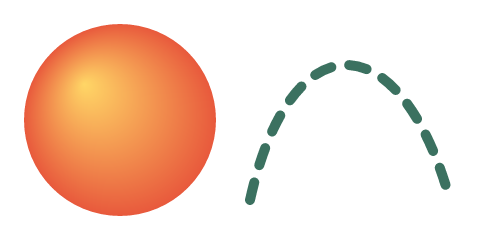
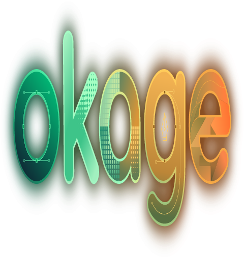
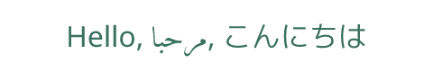
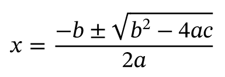
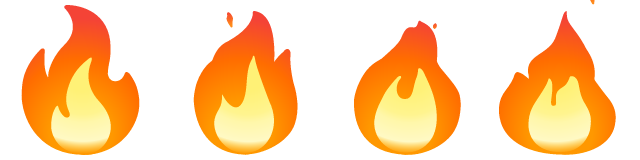

<div align="center">
  
  <br/>
  <a href="#installing" title="Installing">Installing</a> |
  <a href="#examples" title="Examples">Examples</a> |
  <a href="#packages" title="Packages">Packages</a> |
  <a href="#simd-and-tinygo" title="SIMD and TinyGo">SIMD and TinyGo</a> |
  <a href="#documents" title="Documents">Documents</a> |
  <a href="https://pkg.go.dev/github.com/xo/okage" title="Go Reference">Reference</a> |
  <a href="#license" title="License">License</a>
</div>

<br/>

[![Unit Tests][okage-ci-status]][okage-ci]
[![Go Reference][goref-okage-status]][goref-okage]
[![Releases][release-status]][releases]
[![Discord Discussion][discord-status]][discord]

[okage-ci]: https://github.com/xo/okage/actions/workflows/test.yml "Test CI"
[okage-ci-status]: https://github.com/xo/okage/actions/workflows/test.yml/badge.svg "Test CI"
[goref-okage]: https://pkg.go.dev/github.com/xo/okage "Go Reference"
[goref-okage-status]: https://pkg.go.dev/badge/github.com/xo/okage.svg "Go Reference"
[release-status]: https://img.shields.io/github/v/release/xo/okage?display_name=tag "Latest Release"
[releases]: https://github.com/xo/okage/releases "Releases"
[discord]: https://discord.gg/WDWAgXwJqN "Discord Discussion"
[discord-status]: https://img.shields.io/discord/829150509658013727.svg?label=Discord&logo=Discord&colorB=7289da&style=flat-square "Discord Discussion"

# okage

`okage` draws 2D graphics in pure Go. It fills and strokes paths, renders
SVG files, draws Lottie animations, lays out text and math, and writes PDF
files. It needs the Go toolchain and nothing else: no cgo, no C library and
no WebAssembly runtime.

okage is a port of [tiny-skia][ts], the small 2D renderer of the Rust
ecosystem, and of [resvg][resvg], which renders SVG files with tiny-skia.
The renderer gives the same bytes as tiny-skia. okage also ports the
projects around them, such as [velato][velato] for Lottie and
[krilla][krilla] for PDF. [Packages](#packages) lists each one.

## Installing

Add okage to a Go module with this command:

```sh
go get github.com/xo/okage
```

A program that imports okage builds with `CGO_ENABLED=0` for each platform
that Go supports.

## Examples

Each example below is a part of a test in `test/readme`. The test also
draws each image of this section. The example of Lottie draws one frame,
and the test draws four frames for its image.

### Draw shapes

The root package fills and strokes paths onto a `Pixmap`, with a solid
color, a gradient or a pattern. This example fills a circle with a radial
gradient, and strokes a curve with round dashes:

```go
pixmap, _ := okage.NewPixmap(480, 240)
pixmap.Fill(okage.ColorFromRGBA8(255, 255, 255, 255))

// Fill a circle with a radial gradient.
circle, _ := okage.PathFromCircle(120, 120, 96)
paint := okage.DefaultPaint()
paint.AntiAlias = true
paint.Shader, _ = okage.NewRadialGradient(
	okage.PointFromXY(84, 84), 0,
	okage.PointFromXY(120, 120), 96,
	[]okage.GradientStop{
		okage.NewGradientStop(0, okage.ColorFromRGBA8(255, 214, 102, 255)),
		okage.NewGradientStop(1, okage.ColorFromRGBA8(232, 89, 60, 255)),
	},
	okage.SpreadModePad,
	okage.IdentityTransform(),
)
pixmap.FillPath(circle, &paint, okage.FillRuleWinding, okage.IdentityTransform(), nil)

// Stroke a curve with round dashes.
pb := okage.NewPathBuilder()
pb.MoveTo(250, 200)
pb.CubicTo(290, 20, 400, 20, 450, 200)
curve, _ := pb.Finish()
paint.SetColorRGBA8(59, 113, 96, 255)
stroke := okage.DefaultStroke()
stroke.Width = 10
stroke.LineCap = okage.LineCapRound
stroke.Dash, _ = okage.NewStrokeDash([]float32{18, 18}, 0)
pixmap.StrokePath(curve, &paint, &stroke, okage.IdentityTransform(), nil)

if err := pixmap.SavePNG("shapes.png"); err != nil {
	return err
}
```



### Render an SVG file

`svg.New` makes a `Renderer`, which renders SVG data into an `*image.RGBA`
in one call:

```go
data, err := os.ReadFile("docs/okage.svg")
if err != nil {
	return err
}
r := svg.New(svg.WithWidth(480))
img, err := r.Render(data)
if err != nil {
	return err
}
```



A `Renderer` loads the fonts of the system on its first call. The package
also registers the format `svg`, so `image.Decode` reads SVG data.

### Draw text

`svg` shapes text with `typesetting`, which handles each script, the
direction of the text and the fallback from one font to the next. For an
image that is the same on each machine, give the fonts and turn off the
fonts of the system:

```go
data := []byte(`<svg xmlns="http://www.w3.org/2000/svg" width="480" height="80">
  <rect width="100%" height="100%" fill="white"/>
  <text x="240" y="52" font-family="Noto Sans" font-size="32"
        text-anchor="middle" fill="#3B7160">Hello, مرحبا, こんにちは</text>
</svg>`)
r := svg.New(
	svg.WithLoadSystemFonts(false),
	svg.WithFontFile(latin),
	svg.WithFontFile(arabic),
	svg.WithFontFile(japanese),
)
img, err := r.Render(data)
if err != nil {
	return err
}
```



`svg.ShapeText` gives the glyphs and the outlines of a run of text without
SVG data. The package `typesetting/shaping` gives the line breaks and the
shaping of whole paragraphs.

### Lay out math

`texmath` lays out TeX math with the OpenType MATH table of a font, by the
rules of TeX. The package `texmath/stixtwomath` holds the font STIX Two
Math:

```go
f, err := stixtwomath.Font()
if err != nil {
	return err
}
tex := `x = \frac{-b \pm \sqrt{b^2 - 4ac}}{2a}`
box, err := texmath.LayoutTeX(tex, font.NewFace(f), 40, texmath.Display)
if err != nil {
	return err
}
w := uint32(math.Ceil(box.Width)) + 32
h := uint32(math.Ceil(box.Height+box.Depth)) + 32
pixmap, _ := okage.NewPixmap(w, h)
pixmap.Fill(okage.ColorFromRGBA8(255, 255, 255, 255))
paint := okage.DefaultPaint()
paint.AntiAlias = true
box.Draw(pixmap, okage.TransformFromTranslate(16, 16+float32(box.Height)), &paint)
```



`Box.Path` gives the outline of the formula as one path, for a writer of
SVG or PDF.

### Draw a Lottie animation

`lottie` reads Lottie files and dotLottie archives, and draws each frame:

```go
c, err := lottie.Load(data)
if err != nil {
	return nil, err
}
// Draw the middle frame at 256 by 256 pixels.
img, err := c.Image(c.FrameCount()/2, 256, 256)
if err != nil {
	return nil, err
}
```



The animation is the fire emoji of the [Noto animated emoji][noto], under
the [CC BY 4.0][ccby] license.

### Write a PDF file

`pdf` writes PDF files, with paths, gradients, images and text with
subsets of the fonts. `pdfsvg` draws a tree of `svg` onto a page, so this
example converts an SVG file to PDF:

```go
tree, err := svg.FromData(data)
if err != nil {
	return nil, err
}
d := pdf.NewDocument(pdf.WithSVGGlyphs(pdfsvg.RenderGlyph))
ps, _ := pdf.PageSettingsFromWH(tree.Size().Width(), tree.Size().Height())
page := d.StartPage(ps)
pdfsvg.Draw(page.Surface(), tree, tree.Size())
page.Finish()
if err := d.Finish(&w); err != nil {
	return nil, err
}
```

## Packages

| Package | What it does | Port of |
| --- | --- | --- |
| [`okage`][pkg-okage] | Fills and strokes paths, with gradients, patterns, masks and blend modes | [tiny-skia][ts] |
| [`path`][pkg-path] | Builds, transforms, strokes and dashes paths | [tiny-skia-path][ts] |
| [`svg`][pkg-svg] | Parses SVG files into a tree, and renders the tree | [resvg][resvg] and usvg |
| [`lottie`][pkg-lottie] | Reads Lottie files and dotLottie archives, and draws their frames | [velato][velato] |
| [`pdf`][pkg-pdf] | Writes PDF files | [krilla][krilla] |
| [`pdfsvg`][pkg-pdfsvg] | Draws a tree of `svg` onto a page of `pdf` | krilla-svg |
| [`texmath`][pkg-texmath] | Parses TeX math and lays it out with the MATH table of a font | [go-tex/math][gotexmath] |
| [`typesetting`][pkg-typesetting] | Reads fonts, shapes text, breaks lines and runs the bidi algorithm | a copy of [go-text/typesetting][typesetting] |
| [`html`][pkg-html] | Parses HTML documents, and lays out the HTML-like labels of Graphviz | [tinyhtml5][tinyhtml5] |
| [`tinycss2`][pkg-tinycss2] | Parses CSS | [tinycss2][tinycss2] |
| [`cssselect2`][pkg-cssselect2] | Matches CSS selectors | [cssselect2][cssselect2] |
| [`webfont`][pkg-webfont] | Converts WOFF, WOFF2 and EOT fonts to TrueType or OpenType data | none |
| [`roxmltree`][pkg-roxmltree] | Parses XML into a read-only tree | [roxmltree][roxmltree] |
| [`kurbo`][pkg-kurbo] | Curves, shapes and their geometry | a subset of [kurbo][kurbo] |

The root package imports only the Go standard library. `svg` also uses
`golang.org/x/image/webp` for WebP files.

okage differs from its upstreams only where a decision says so.
[docs/DIFFERENCES.md](docs/DIFFERENCES.md) lists each difference, and each
API that okage adds. [docs/STATUS.md](docs/STATUS.md) gives the state of each
package, and the upstream commit that it follows.

## SIMD and TinyGo

okage uses SIMD where Go can, and its scalar code is the fallback. SIMD
(single instruction, multiple data) means one instruction that works on
several values at once. Go 1.27 has SIMD only as an experiment, so okage
has two builds:

1. The scalar build is the default.
2. The SIMD build uses the package `simd/archsimd` of Go on amd64, arm64 and
   WebAssembly. A program gets it when it builds with `GOEXPERIMENT=simd`.

```sh
GOEXPERIMENT=simd go build ./...
```

Both builds give the same bytes for each image. On an amd64 CPU without
AVX2, the SIMD build uses the scalar code. When Go makes SIMD a standard
feature, the SIMD build becomes the default. [docs/SIMD.md](docs/SIMD.md)
holds the details.

okage also builds with [TinyGo][tinygo], which always uses the scalar code.
A build for WebAssembly is a goal that each package keeps in mind.

## Documents

| Document | What it holds |
| --- | --- |
| [docs/STATUS.md](docs/STATUS.md) | the state of each package, and the upstream commits that okage follows |
| [docs/DIFFERENCES.md](docs/DIFFERENCES.md) | each difference from upstream, and each API that okage adds |
| [docs/PLAN.md](docs/PLAN.md) | the plan, the testing plan, the phases and the open questions |
| [docs/UPSTREAM.md](docs/UPSTREAM.md) | the rules for porting each upstream repository and each change that it makes |
| [docs/SIMD.md](docs/SIMD.md) | the rules for the vector code, the two builds and the SIMD packages of Go |
| [docs/BACKLOG.md](docs/BACKLOG.md) | the work that is known and not done |
| [docs/FORMATS.md](docs/FORMATS.md) | a survey of the work to support other vector formats, such as PDF, EPS and DWG |
| [docs/decisions/](docs/decisions/README.md) | each decision, one file each, with an index |
| [CONTRIBUTING.md](CONTRIBUTING.md) | how to change okage |
| [AGENTS.md](AGENTS.md) | the rules for a coding agent, which also hold for a person |

## License

okage keeps the license of each upstream project. Each folder that holds
code from an upstream project holds the license of that project, in a file
`LICENSE`, `NOTICE` or `OFL.txt`. [LICENSE](LICENSE) in the root is the
BSD-3-Clause license of tiny-skia, and it covers the root package and
`path`.

<div align="center">
  <a href="https://github.com/xo/usql" title="A command line client for many databases">usql</a> |
  <a href="https://github.com/xo/dburl" title="Database connection URLs">dburl</a> |
  <a href="https://github.com/xo/dbmeta" title="Database metadata">dbmeta</a> |
  <a href="https://github.com/xo/dbimp" title="Database drivers in pure Go">dbimp</a> |
  <a href="https://github.com/xo/cassandra" title="A database/sql driver for Cassandra">cassandra</a> |
  <a href="https://github.com/xo/dbtpl" title="Go code generated from a database">dbtpl</a> |
  <a href="https://github.com/xo/tblfmt" title="Tables of database results">tblfmt</a> |
  <a href="https://github.com/xo/rline" title="The line editor of usql">rline</a> |
  <a href="https://github.com/xo/transit" title="tree-sitter in pure Go">transit</a> |
  <a href="https://github.com/xo/okage" title="tiny-skia in pure Go, this project">okage</a>
</div>

[ts]: https://github.com/linebender/tiny-skia
[resvg]: https://github.com/linebender/resvg
[velato]: https://github.com/linebender/velato
[krilla]: https://github.com/LaurenzV/krilla
[tinyhtml5]: https://github.com/CourtBouillon/tinyhtml5
[tinycss2]: https://github.com/Kozea/tinycss2
[cssselect2]: https://github.com/Kozea/cssselect2
[roxmltree]: https://github.com/RazrFalcon/roxmltree
[kurbo]: https://github.com/linebender/kurbo
[tinygo]: https://tinygo.org
[typesetting]: https://github.com/go-text/typesetting
[gotexmath]: https://github.com/go-tex/math
[noto]: https://googlefonts.github.io/noto-emoji-animation/
[ccby]: https://creativecommons.org/licenses/by/4.0/
[pkg-okage]: https://pkg.go.dev/github.com/xo/okage
[pkg-path]: https://pkg.go.dev/github.com/xo/okage/path
[pkg-svg]: https://pkg.go.dev/github.com/xo/okage/svg
[pkg-lottie]: https://pkg.go.dev/github.com/xo/okage/lottie
[pkg-pdf]: https://pkg.go.dev/github.com/xo/okage/pdf
[pkg-pdfsvg]: https://pkg.go.dev/github.com/xo/okage/pdfsvg
[pkg-texmath]: https://pkg.go.dev/github.com/xo/okage/texmath
[pkg-typesetting]: https://pkg.go.dev/github.com/xo/okage/typesetting
[pkg-html]: https://pkg.go.dev/github.com/xo/okage/html
[pkg-tinycss2]: https://pkg.go.dev/github.com/xo/okage/tinycss2
[pkg-cssselect2]: https://pkg.go.dev/github.com/xo/okage/cssselect2
[pkg-webfont]: https://pkg.go.dev/github.com/xo/okage/webfont
[pkg-roxmltree]: https://pkg.go.dev/github.com/xo/okage/roxmltree
[pkg-kurbo]: https://pkg.go.dev/github.com/xo/okage/kurbo
