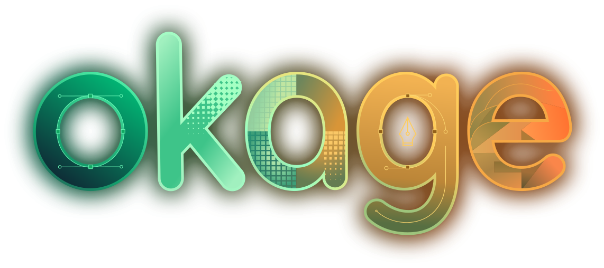

<div align="center">
  
  <br/>
  <a href="#status" title="Status">Status</a> |
  <a href="#installing" title="Installing">Installing</a> |
  <a href="#simd" title="SIMD">SIMD</a> |
  <a href="#documents" title="Documents">Documents</a> |
  <a href="#differences-from-upstream" title="Differences from upstream">Differences from upstream</a> |
  <a href="https://pkg.go.dev/github.com/xo/okage" title="Go Reference">Reference</a> |
  <a href="#license" title="License">License</a>
</div>

<br/>

[![Unit Tests][okage-ci-status]][okage-ci]
[![Go Reference][goref-okage-status]][goref-okage]
[![Releases][release-status]][releases]
[![Discord Discussion][discord-status]][discord]

[okage-ci]: https://github.com/xo/okage/actions/workflows/test.yml "Test CI"
[okage-ci-status]: https://github.com/xo/okage/actions/workflows/test.yml/badge.svg "Test CI"
[goref-okage]: https://pkg.go.dev/github.com/xo/okage "Go Reference"
[goref-okage-status]: https://pkg.go.dev/badge/github.com/xo/okage.svg "Go Reference"
[release-status]: https://img.shields.io/github/v/release/xo/okage?display_name=tag "Latest Release"
[releases]: https://github.com/xo/okage/releases "Releases"
[discord]: https://discord.gg/WDWAgXwJqN "Discord Discussion"
[discord-status]: https://img.shields.io/discord/829150509658013727.svg?label=Discord&logo=Discord&colorB=7289da&style=flat-square "Discord Discussion"

# okage

`okage` is a pure Go port of [tiny-skia][ts] and of [resvg][resvg].

1. tiny-skia is a small 2D renderer in Rust, and it is a subset of
   [Skia][skia], the renderer of Chrome. It fills and strokes paths with a
   solid color, a gradient or a pattern. It dashes strokes, clips with a mask
   and blends images. It renders on the CPU only. okage ports it into the root
   package and the package `path`.
2. resvg renders SVG files with tiny-skia. okage ports it into the package
   `svg`.
3. [velato][velato] renders Lottie animations. okage ports it into the package
   `lottie`, which draws with okage (D41).
4. [tinyhtml5][tinyhtml5], [tinycss2][tinycss2] and [cssselect2][cssselect2]
   parse HTML, parse CSS and match CSS selectors in Python, for WeasyPrint.
   okage ports them into the packages `html`, `tinycss2` and `cssselect2`
   (D49, D50).

Today [`xo/resvg`][xoresvg] wraps resvg through cgo and a static archive for
each platform. A program that imports okage needs the Go toolchain and nothing
else.

okage uses SIMD where Go can, and its scalar code is the fallback. SIMD
(single instruction, multiple data) means one instruction that works on
several values at once. A build with [TinyGo][tinygo], most of all for
WebAssembly, is a goal that the port keeps in mind.

## Status

The port of tiny-skia is done, in the root package and in `path`. It gives
the same bytes as tiny-skia in the scalar build, in the SIMD build and with
TinyGo, and the 157 integration tests of tiny-skia pass. It is about 1.2 to
3 times slower than the scalar code of tiny-skia, and work that makes it
faster stays open (D35). The package `svg` is the port of usvg and
resvg. It parses and renders each test file of resvg: without text and
without a raster image, with the same pixels as resvg, and with text or an
image, within the tolerance of D31. The package `lottie` is the port of
velato. It gives the same calls to its sink as velato for each of the 879
Noto animated emoji, and each sampled frame of them is within the tolerance of
D43 of ThorVG. [docs/PLAN.md](docs/PLAN.md) holds the plan, the phases and the
open questions.

The port starts from resvg `v0.49.0` and from the versions of the crates that
it uses, such as tiny-skia `v0.12.0`. After each base port, okage follows each
upstream commit. On 2026-11-12 okage follows resvg up to its commit `5bdbae64`
of 2026-11-11. `docs/upstream/upstreams.tsv` lists the upstream
repositories, and one ledger for each records what okage did with each commit.

## Installing

Install okage with this command:

```sh
go get github.com/xo/okage
```

The renderer imports only the Go standard library. The package `svg` also
uses `typesetting` for text, and `golang.org/x/image/webp` for WebP files.
`typesetting` is a public copy of [`go-text/typesetting`][typesetting] in
okage (D52). okage does not use cgo, so a program that imports it builds with
`CGO_ENABLED=0` for every platform that Go supports.

## SIMD

Go 1.27 has SIMD only as an experiment, so okage has two builds:

1. The scalar build is the default.
2. The SIMD build uses the package `simd/archsimd` of Go on amd64, arm64 and
   WebAssembly. A program gets it when it builds with `GOEXPERIMENT=simd`.

```sh
GOEXPERIMENT=simd go build ./...
```

Both builds give the same bytes for every image. On an amd64 CPU without
AVX2, the SIMD build uses the scalar code. TinyGo always uses the scalar code.
When Go makes SIMD a standard feature, the SIMD build becomes the default.
[docs/SIMD.md](docs/SIMD.md) holds the details.

## Documents

| Document | What it holds |
| --- | --- |
| [docs/PLAN.md](docs/PLAN.md) | the plan, the testing plan, the phases and the open questions |
| [docs/UPSTREAM.md](docs/UPSTREAM.md) | the rules for porting each upstream repository and each change that it makes |
| [docs/SIMD.md](docs/SIMD.md) | the rules for the vector code, the two builds and the SIMD packages of Go |
| [docs/BACKLOG.md](docs/BACKLOG.md) | the work that is known and not done |
| [docs/FORMATS.md](docs/FORMATS.md) | a survey of the work to support other vector formats, such as PDF, EPS and DWG |
| [docs/decisions/](docs/decisions/README.md) | every decision, one file each, with an index |
| [CONTRIBUTING.md](CONTRIBUTING.md) | how to change okage |
| [AGENTS.md](AGENTS.md) | the rules for a coding agent, which also hold for a person |

## Differences from upstream

okage differs from upstream only where a decision says so:

1. The SIMD build computes a reciprocal exactly. The SIMD backends of
   tiny-skia approximate it in the blend modes color dodge and color burn,
   and its scalar backend computes it exactly (D16).
2. `svg` decodes PNG, JPEG and GIF files with the standard library, and WebP
   files with `golang.org/x/image/webp`, in place of the decoders of resvg
   (D7).
3. `svg` finds fonts and shapes text with `typesetting`, the copy of
   [`go-text/typesetting`][typesetting] in okage, in place of the crates of
   resvg. Its text can differ from the text of resvg (D9, D52).
4. Each package logs to a `*slog.Logger` that the caller gives (D20).
5. An elliptical arc makes at most 4,096 cubic curves. kurbo has no limit, so
   an arc with a radius of about 4.23e20 or more does not end in upstream
   (D30).
6. The gamma stages give one result for every NaN. Upstream reads the bits
   of a NaN there, and they differ between x86 and ARM (D34).
7. The fallback of text skips a character that no font draws, and goes on
   with the characters after it. Upstream stops at that character, so the
   characters after it get no fallback (D39). The fallback also replaces
   whole clusters, where upstream copies glyphs one by one, so an emoji
   sequence such as a flag falls back with the text around it (D39).
8. The fallback of text also goes on for an emoji that the font does not
   draw as an emoji: a character with U+FE0F without a color glyph, such as
   "©️" in a text font, and an emoji sequence that the font draws as several
   glyphs. Upstream falls back only for a missing glyph (D40).

9. `lottie` draws as ThorVG where velato differs: the opacity, the opacity
   stops, the radius and the highlight of gradients, solid layers, time
   remap, easing, spatial positions, the closing of animated shapes, the
   opacity and the blend mode of layers, masks and stroke dashes (D43).
   `Renderer.MergePaths` draws merge paths by compositing, which velato and
   ThorVG do not, and it is off by default (D42).
10. `html` builds a tree with a node for each run of text, where tinyhtml5
    builds an ElementTree of Python. It goes on where upstream raises an
    error, and options bound the depth, the nodes and the issues of a parse
    (D49).
11. `tinycss2` nests at most 256 blocks and `cssselect2` at most 32
    selectors, where upstream has no limit. Where upstream raises an
    exception for a selector or a color, the port returns a `SelectorError`
    or no color (D50).
12. A fill clamps each side of the bounds of a path to 2^26 pixels from the
    origin before it rounds them. Upstream panics or leaves out rows for an
    antialiased fill with a point past about 2^29 pixels, and draws nothing
    for a fill without antialiasing of a path wider or taller than 2^31
    pixels. `DrawPixmap` of an image that is aligned to the pixels skips the
    stages of the pipeline, with the same bytes (D53).
13. A hairline on a pixmap of 1 or 2 rows or columns draws its pixels.
    Upstream draws nothing there (D54).

When upstream changes the code of a difference, okage removes its own code
and ports the change of upstream. D40 gives the steps for items 7 and 8, and
D42 and D43 give them for item 9.

okage also adds APIs that upstream does not have:

1. A `Pixmap` gives an `*image.RGBA` that shares its bytes, and it implements
   `image.Image` and `draw.Image` (D19).
2. `svg.New` makes a `Renderer`, which renders SVG data into an
   `*image.RGBA` in one call, as `xo/resvg` does. It loads the fonts of the
   system on its first call, and sets each generic family to the first of a
   list of common fonts that is installed. The package registers the format
   `svg` with `image.RegisterFormat`, so `image.Decode` reads SVG data (D36).
   `FontDatabase.LoadOSFonts` loads the same fonts into a database of the
   program (D46).
3. `svg.ShapeText` lays out a run of text with the fonts, the fallback and
   the shaping of `svg`, and gives its advance width and the outlines of its
   glyphs as a path, so that a program can draw text without SVG data (D37).
   `TextRun.RenderColorGlyphs` draws its color glyphs, such as color emoji
   (D39).
4. `html.Parse` parses an HTML-like label of Graphviz, `label=<...>` in DOT,
   and `Label.Layout` lays it out as `dot` does: the boxes of the tables and
   the cells, the rules, the runs of text and the ports (D38).
5. `lottie.Parse` reads a Lottie file, and `lottie.RenderFrame` draws a
   frame of it onto an okage pixmap through `PixmapSink`, the sink of
   `lottie` that draws with okage (D41).
6. `lottie.Detect` finds a Lottie document from the start of a file, and
   `lottie.OpenDotLottie` reads a dotLottie archive. `lottie.Load` parses
   either one. `Composition.Image` draws a frame into an `*image.RGBA` of a
   given size, and `FrameCount` and `Duration` count and time the frames
   (D44).
7. `FontDatabase.LoadFontData` loads a font in WOFF, WOFF2 or EOT, as well
   as TrueType and OpenType data. `svg.ConvertFontData` converts such a font
   to TrueType or OpenType data. `FontDatabase.FaceName` returns a string of
   the name table of a face, such as the version or the sample text (D45).
   The package `webfont` gives the same conversion to a program that does not
   use `svg` (D51).
8. `Paint.Coverage` fills a path with 8 by 8 samples in each pixel, in place
   of the 4 by 4 of tiny-skia, and `Paint.StrokeAdjust` moves a thin stroke
   onto the pixel grid, as stroke adjustment does in PDF (D54).
9. `MeshGradient`, which `NewMeshGradient` makes, fills a mesh of triangles
   with a color at each corner, for the shadings of the types 4 to 7 of PDF
   and PostScript. `SpreadModeDecal` makes a gradient transparent before its
   start and after its end, as the decal tile mode of Skia does (D55).
10. `MaskFromLuminance` and `Mask.ApplyTransfer` make the soft masks of PDF
    with a backdrop color and a transfer function. `Pixmap.RemoveBackdrop`
    and `Pixmap.Knockout` composite the groups of PDF that are not isolated
    and the knockout groups (D56).
11. `TextStyle` also takes the stretch, the variations, the features, the
    language and the spacing of a run, and `TextRun.Clusters` gives the
    bytes, the advance and the glyphs of each cluster. `FontDatabase` gives
    the parsed faces, the cmaps and the metrics that it keeps, and
    `AutoFontVariations` maps a CSS weight, stretch and style to the axes of
    a variable font. `FontDatabase.ColorGlyph` gives a glyph of COLR or of
    the table SVG as a tree (D57).
12. `svg.ReadDimensions` reads the size and the viewBox of an SVG image
    before the parse. `svg.FromXMLTree` and `svg.FromXMLNode` make a tree
    from a document of roxmltree, and `roxmltree.Builder` makes such a
    document without XML text. `svg.WithZeroSize` accepts an image of size
    zero (D58).
13. The package `typesetting/font/cff` exports the predefined charsets of
    CFF, and draws the accented glyphs of `seac` and the FontMatrix of each
    font dictionary (D59).

The output of `svg` is compared with resvg and with libvips within a
tolerance, not byte for byte (D23). The renderer gives the same bytes as
tiny-skia.

## License

The root package and `path` are under the BSD-3-Clause license of tiny-skia.
See [LICENSE](LICENSE), which keeps the copyright lines of upstream. The
package `svg` and the packages that it uses take the MIT license of resvg and
of its crates, in a `LICENSE` file in each folder (D13). The package `html`
takes the MIT license of tinyhtml5, in [html/LICENSE](html/LICENSE). That
license also covers the parser of the labels of Graphviz (D49). The packages
`tinycss2` and `cssselect2` keep the BSD-3-Clause licenses of their upstreams,
in [tinycss2/LICENSE](tinycss2/LICENSE) and
[cssselect2/LICENSE](cssselect2/LICENSE) (D50).
The brotli decoder in `internal/brotli` is a copy of the one of
`github.com/dsnet/compress`, and keeps its BSD-3-Clause license, in
[internal/brotli/LICENSE](internal/brotli/LICENSE) (D45). The packages
under `typesetting` are a copy of go-text, and keep its license, the
Unlicense or the BSD-3-Clause license, in
[typesetting/LICENSE](typesetting/LICENSE). The package `harfbuzz` keeps the
MIT license of HarfBuzz in
[typesetting/harfbuzz/LICENSE](typesetting/harfbuzz/LICENSE) (D52). The
package `lottie` takes the MIT license of velato, in
[lottie/LICENSE](lottie/LICENSE). Its test files are Noto animated emoji
under CC BY 4.0, as [lottie/testdata/NOTICE](lottie/testdata/NOTICE) says.

<div align="center">
  <a href="https://github.com/xo/usql" title="A command line client for many databases">usql</a> |
  <a href="https://github.com/xo/dburl" title="Database connection URLs">dburl</a> |
  <a href="https://github.com/xo/dbmeta" title="Database metadata">dbmeta</a> |
  <a href="https://github.com/xo/dbimp" title="Database drivers in pure Go">dbimp</a> |
  <a href="https://github.com/xo/cassandra" title="A database/sql driver for Cassandra">cassandra</a> |
  <a href="https://github.com/xo/dbtpl" title="Go code generated from a database">dbtpl</a> |
  <a href="https://github.com/xo/tblfmt" title="Tables of database results">tblfmt</a> |
  <a href="https://github.com/xo/rline" title="The line editor of usql">rline</a> |
  <a href="https://github.com/xo/transit" title="tree-sitter in pure Go">transit</a> |
  <a href="https://github.com/xo/okage" title="tiny-skia in pure Go, this project">okage</a>
</div>

[ts]: https://github.com/linebender/tiny-skia
[skia]: https://skia.org
[resvg]: https://github.com/linebender/resvg
[velato]: https://github.com/linebender/velato
[tinyhtml5]: https://github.com/CourtBouillon/tinyhtml5
[tinycss2]: https://github.com/Kozea/tinycss2
[cssselect2]: https://github.com/Kozea/cssselect2
[xoresvg]: https://github.com/xo/resvg
[tinygo]: https://tinygo.org
[typesetting]: https://github.com/go-text/typesetting
